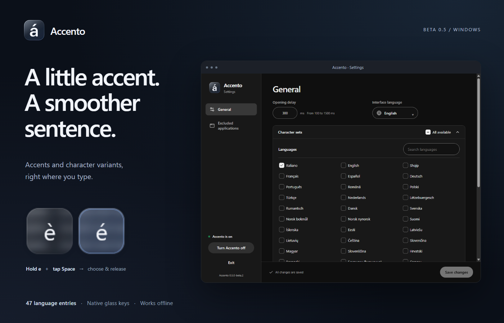
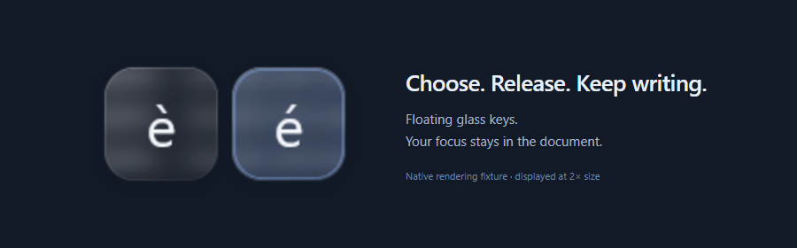
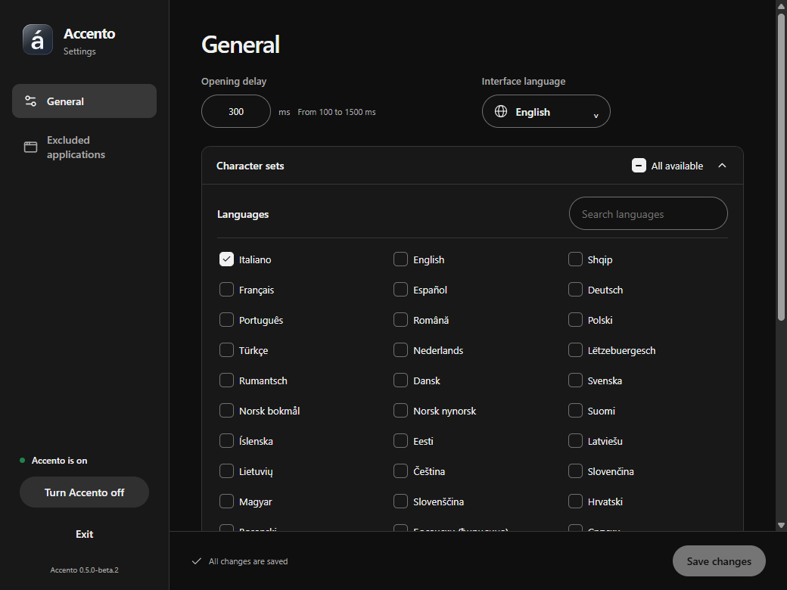
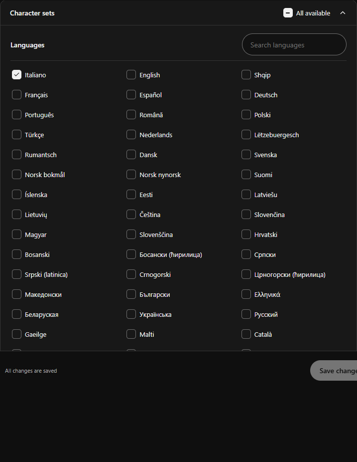
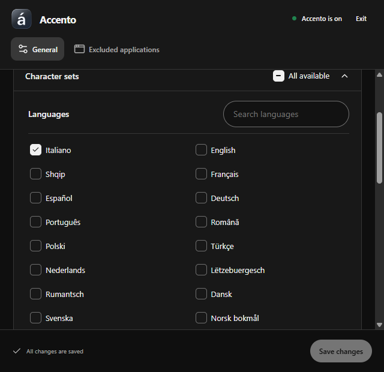

<p align="center">
  
</p>

<h1 align="center">Accento</h1>

<p align="center">
  <strong>Accents, right where you type.</strong><br>
  Hold a letter. Tap Space. Choose its character.
</p>

<p align="center">
  
</p>

<p align="center">
  <a href="#get-started">Get started</a> ·
  <a href="#a-small-gesture-for-more-characters">How it works</a> ·
  <a href="#screenshots">Screenshots</a> ·
  <a href="docs/DEVELOPMENT.md">Development</a> ·
  <a href="README.it.md">Italiano</a>
</p>

<p align="center">
  
</p>

## A small gesture for more characters

Writing *caffè*, *français* or *piñata* should not mean opening a character map. Accento keeps accents and character variants close to your keyboard, with independent floating glass keys and a selection you confirm by releasing the letter.

| Hold | Choose | Release |
| --- | --- | --- |
| Hold a letter and tap Space. | The first variant is already selected. Use ← / → or tap Space again to move. | Release the letter to insert the selection. Esc cancels. |

For example: hold `e`, press and release Space, wait for the picker, then release `e` to insert `è`. Start with Shift or Caps Lock for uppercase variants. A quick gesture that ends before the picker opens preserves ordinary typing.

The **Currency** special set is enabled initially: `e` also offers `€`, after the Italian accents `è` and `é`. Toggle it under **General → Character sets → Special sets** and expand its variants to see all key mappings, including `s` → `$`, `l` → `£` and `y` → `¥`. Symbols stay the same with Shift or Caps Lock.

## Get started

**[Download Accento 0.5.0-beta.2](https://github.com/M3GA17/Accento/releases/tag/v0.5.0-beta.2)** — Windows x64 installer, portable ZIP and SHA-256 checksums. This repository is private; downloads require repository access. Linux/macOS backends are included in the source; this release ships Windows binaries only. See the [release notes](docs/releases/v0.5.0-beta.2.md).

| Platform | Status |
| --- | --- |
| Windows 11 · Intel/AMD 64-bit | Native implementation; beta installer and portable ZIP available |
| Linux X11 | Native backend implemented; Linux build and isolated live-input tests passed |
| macOS Intel / Apple Silicon | Native backend implemented and type-checked for both architectures; full app and live-input verification need a Mac |

The gesture engine and preferences are shared. Windows retains its Win32 backend; Linux uses XInput2/XTEST, and macOS uses Quartz and Accessibility. **Native Wayland input is not implemented** and remains disabled with an explanation in settings. See [platform setup, verification and limits](docs/cross-platform.md).

### Windows installer

Run `Accento_0.5.0-beta.2_windows-x64-setup.exe`. It installs for your Windows user and can download Microsoft Edge WebView2 Runtime if needed. An internet connection may be required for that prerequisite; Accento itself works offline.

### Portable ZIP

Extract **the entire archive**, then open `Accento.exe`. Keep the guides and license files beside it. WebView2 must already be installed. Preferences live in `%LOCALAPPDATA%\Accento\settings.json`, so “portable” describes the app files rather than a fully isolated settings folder.

Neither package needs PowerToys, .NET, Node.js or Rust to run. These beta binaries are unsigned and have no automatic updater. Verify the downloaded files against the supplied `SHA256SUMS.txt` on the release page.

## Screenshots

The settings images below are captured from the Windows app with a separate example profile. The glass picker image comes from the native rendering test, on a controlled sample background.

### Glass character keys

An independent card for every variant, with the selected character ready to insert. The popup leaves keyboard focus in the app where you are writing.

<p align="center">
  
</p>

### Settings that stay out of the way

Set the delay, search your character sets and choose an interface language independently. Pause immediately, keep a draft, and save when ready.

<p align="center">
  
</p>

<details>
  <summary>Character sets and compact layout</summary>
  <p align="center"></p>
  <p align="center"></p>
</details>

## Your languages, your workflow

- **47 language entries and written variants**, including Latin, Greek, Cyrillic, Armenian and Georgian scripts. Search by language name or code.
- **Separate interface and character choices.** Read the app in one language and activate several character sets.
- **Complete candidate strings**, including supported digraphs and combining marks, with uppercase variants.
- **Adjustable delay**, from 100 to 1500 ms; the default is 300 ms.
- **Application exclusions** by executable name, such as `notepad.exe`.
- **Notification-area controls** to pause, resume, open settings or exit. Closing settings keeps the engine running.

The [coverage matrix](docs/copertura-europa.md) lists the exact scope, source data and 47 quick-start guides. It covers national/official written languages in the chosen European scope, not every regional language or every historical character. New translations are drafts awaiting native-speaker review.

## Privacy and beta limitations

Accento does not store typed sentences, a key history or field contents, and uses no network service. Settings are saved locally. Glass samples a small backdrop at the start of a gesture and keeps it in memory; high-contrast or reduced-transparency settings may use an opaque surface instead.

This is a beta. Input replacement uses Windows Unicode input and remains subject to application permissions and behavior. Elevated apps, IMEs, remote sessions, protected fields and some keyboard layouts need specific testing. Password detection does not cover every browser field. Pause other accent tools using the same gesture while trying Accento. The [usage guide](docs/uso.md#requisiti-e-limiti-della-prima-versione) records the detailed Windows limits; the [platform guide](docs/cross-platform.md) covers Linux and macOS.

## Development

The app combines a **shared Rust gesture engine**, **native OS input integrations**, and **React / TypeScript settings in Tauri 2**. Windows keeps its native glass picker; Unix hosts use a transparent, non-focusable Tauri picker. UI components, styles and dark-theme tokens are maintained locally in `ui/src/components` and `ui/src/theme.css`; React Aria provides accessible interaction behavior. No DimaLabs packages or sibling checkouts are required.

```powershell
npm ci
npm run desktop
```

For a transient browser layout preview, use `npm run dev` and open `http://127.0.0.1:1421/?preview=1`. Preview data never changes your desktop preferences.

See the [development guide](docs/DEVELOPMENT.md) for prerequisites, checks, packaging and architecture, and the [release guide](docs/RELEASING.md) for the local preparation and manual publication process. No release automation is enabled.

## Contributing

Bug reports are most useful with the OS and desktop-session version, keyboard layout, target application, active character sets and exact gesture. Translation feedback should include the language code and the wording to improve. The catalog is based on pinned Unicode CLDR data; provenance is recorded in [`localization/`](localization/README.md).

Accento source is available under the [MIT license](LICENSE). Dependencies retain their own terms; see [third-party notices](THIRD-PARTY-NOTICES.md).

---

<p align="center">A little accent. A smoother sentence.</p>
