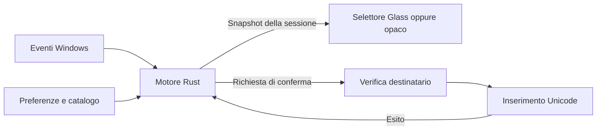
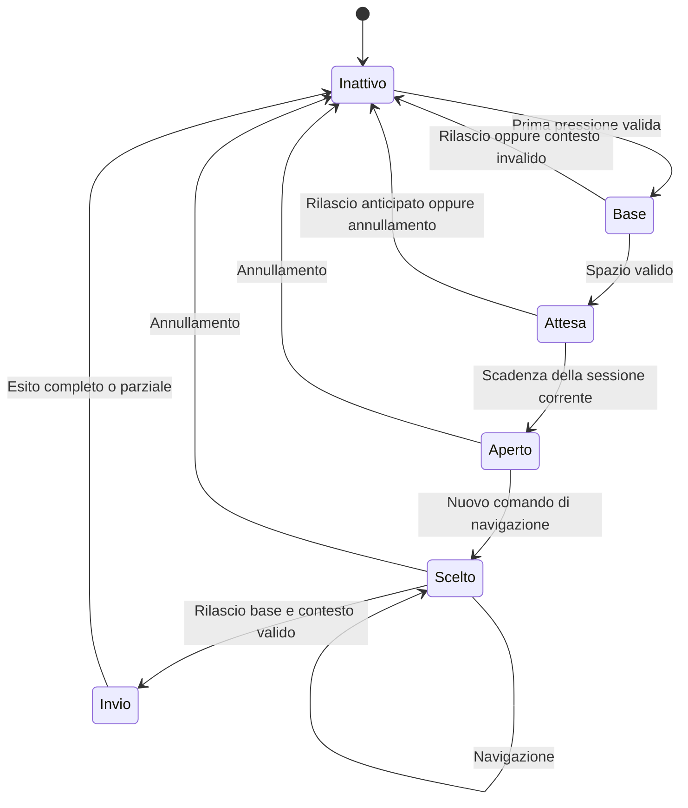

# Piano per ricreare Quick Accent in Rust con il design Glass di Accento

Proposta del 15 ottobre 2026, basata sull'[analisi Quick Accent](reverse-engineering-quick-accent.md) e sui documenti di prodotto. La prima consegna deve dimostrare `e → selettore → è` in una finestra destinataria reale, conservando il focus e gestendo annullamento e digitazione ordinaria. Il materiale Glass arriva sulla stessa finestra dopo questa verifica.

Rust, indipendenza da PowerToys e ispirazione Apple Glass sono decisioni acquisite. La proposta tecnica iniziale è **motore Rust puro e selettore Windows nativo**. Framework definitivo, versioni delle dipendenze e sistema minimo rimangono subordinati agli esperimenti.

## Cosa conservare e cosa cambiare

| Aspetto | Quick Accent analizzato | Proposta Accento |
| --- | --- | --- |
| Gesto | Spazio, frecce, entrambi e pressione prolungata nel sorgente della versione | Prima modalità lettera più Spazio; pressione prolungata successiva |
| Apertura e prima scelta | Il trigger può già selezionare; frecce con partenza centrale opzionale | Dal 16 ottobre: primo candidato preselezionato; i comandi successivi navigano |
| Conferma | Rilascio della lettera proprietaria | Stessa regola, con controllo del destinatario |
| False partenze | Restituzione del trigger nei modi pertinenti | Spazio restituito una sola volta se il gesto termina prima della soglia |
| Ordinamento | Catalogo stabile e frequenza opzionale | Ordine stabile e deduplicazione; frequenza fuori dalla prima versione |
| Maiuscole | Conversione nel Core, comprese eccezioni | Famiglia acquisita all'avvio, verificata rispetto al layout |
| Posizione | Configurabile; installazione locale in alto al centro | Prima posizione in basso al centro del monitor destinatario |
| Sostituzione | Backspace e Unicode in due invii separati | Confrontare invio unico e separato; esiti parziali espliciti |
| Aspetto | UI WinUI con superficie e scorrimento | Superficie Glass propria, testo dominante, alternativa opaca |
| Ciclo di vita | Integrato in PowerToys | Processo autonomo, tray, pausa, impostazioni e uscita |

## Architettura da prototipare

Due crate iniziali sono sufficienti. I moduli si separano ulteriormente solo quando il confine rende più semplice una prova o una modifica.

| Parte | Contenuto | Contratto |
| --- | --- | --- |
| `accento-core` | Macchina a stati, catalogo, ordinamento e regole di selezione | Riceve eventi e tempo monotono; restituisce decisione sull'evento, stato ed effetti; nessuna API Windows |
| `accento-windows` | Eseguibile e coordinamento | Possiede hook, contesto, inserimento, selettore, tray e preferenze |
| Modulo tastiera | Normalizzazione eventi, ripetizioni, modificatori, marcatore proprio | Decide passaggio o consumo in modo sincrono; esegue solo lavoro limitato |
| Modulo destinatario | Finestra, processo, thread e controllo focalizzato quando disponibile | Produce un'identità di contesto e ne verifica la validità prima dell'invio |
| Modulo inserimento | Backspace, Unicode UTF-16, conteggi SendInput | Restituisce esiti distinti e non reinvia dopo un errore parziale |
| Modulo selettore | Finestra non attivante, misure del testo, rendering e accessibilità | Presenta uno snapshot del motore con identificativo di sessione |
| Preferenze e catalogo | Schema, validazione e salvataggio locale | Snapshot immutabili durante il gesto; aggiornamenti validi dal gesto successivo |

Il motore può vivere sul thread dedicato all'hook per garantire che passaggio e consumo siano decisi prima del ritorno. Rendering, disco, risoluzione delle esclusioni e operazioni lente restano fuori dal callback. Candidati e preferenze devono essere già disponibili; un contesto non valutabile non abilita l'attivazione. Occorre verificare la freschezza delle informazioni memorizzate senza introdurre attese nel callback.

Le richieste di inserimento conservano l'ordine rispetto agli eventi fisici. Un semplice invio asincrono dopo il rilascio non basta: nuovo input o cambio di focus possono precederlo. L'esperimento deve confrontare un percorso immediato e limitato con una coda seriale invalidabile. Se l'ordine non è più garantito, annulla l'effetto pendente. L'eventuale attesa di compatibilità fra Backspace e Unicode deve restare fuori dal callback; la soluzione va scelta con prove di interleaving nei terminali.

Il [contratto degli hook Windows](https://learn.microsoft.com/en-us/windows/win32/winmsg/lowlevelkeyboardproc) richiede un ciclo messaggi sul thread installante e tempi brevi. Lo stato asincrono del tasto corrente non è ancora aggiornato durante la callback: il modello dei tasti premuti deve integrare esplicitamente l'evento ricevuto.

## Contratto proposto per il primo gesto

Queste regole rendono verificabili le ambiguità della definizione iniziale. Sono il comportamento del prototipo da valutare, non una dichiarazione di identità con Quick Accent.

1. Il primo down della lettera passa al destinatario. Il motore registra base, famiglia, contesto e identificativo di sessione.
2. Un down successivo di Spazio con la base ancora premuta e candidati validi entra in attesa. Consuma il trigger e fa partire **un solo timer da quel momento**, senza selezionare un candidato. Le ripetizioni del trigger non riavviano il timer.
3. Alla scadenza, se sessione e contesto sono validi, appare il selettore con il primo candidato già selezionato. Il primo esperimento può usare 300 ms come valore di confronto con l'installazione locale; il valore predefinito richiede prove di scrittura.
4. Solo un nuovo down volontario dopo il rilascio del trigger naviga: Spazio o Destra passano al secondo candidato; Sinistra all'ultimo. In seguito si avanza o retrocede con ritorno all'altro estremo. L'autorepeat non naviga nel primo prototipo.
5. Il rilascio della base conferma soltanto un candidato selezionato; il rilascio del solo Spazio non conferma. Una volta aperto il selettore, il rilascio conferma il primo candidato anche senza navigazione. Esc conserva la base.
6. Se la base viene rilasciata durante l'attesa iniziale, ripristina una sola pressione di Spazio quando il destinatario è ancora valido. Se il contesto è cambiato, annulla senza inviare al nuovo contesto.
7. Esc annulla e conserva la base. Un altro carattere o Ctrl, Alt, AltGr o Windows annulla lasciando proseguire l'input ordinario. Shift/Caps successivi non cambiano la famiglia della sessione nella prima prova.
8. Qualsiasi ripetizione della base già passata prima del trigger impedisce di armare il gesto fino al rilascio: un singolo Backspace non potrebbe sostituire una quantità incerta di lettere. Dopo l'attivazione, sopprime le ripetizioni della base proprietaria fino al rilascio.

Per ogni tasto consumato occorre definire anche il trattamento del relativo up. Una tabella di tracce deve dimostrare che conferma, annullamento, pausa ed errore non lasciano stati incoerenti nei programmi e negli altri hook. Gli eventi marcati come propri non aprono sessioni; gli input sintetici di altri strumenti richiedono una politica esplicita, senza scartarli indiscriminatamente.

Timer, comandi grafici e risposte dell'inserimento portano la generazione della sessione. Un risultato di una sessione chiusa non può riaprire il selettore né modificare una scelta successiva.

## Prova del destinatario e della sostituzione

La prima prova opera su lettere precomposte in un campo ordinario senza selezione. Non legge frasi o cronologia e non presume di ricostruire il documento del destinatario. Prima della conferma ricontrolla il contesto osservabile; cambio di finestra, controllo focalizzato, input incompatibile o contesto incerto annullano la sessione.

Il controllo di finestra e focus non può dimostrare che cursore e contenuto siano rimasti identici. Mouse, selezioni, autocorrezione e destinatari lenti richiedono tracce manuali dedicate. La possibilità di disabilitare contesti non supportati è parte della prima verifica.

Confrontare un batch di cancellazione e Unicode con due invii ordinati. Registrare solo conteggi ed esiti tecnici privi di testo digitato. Se Backspace riesce e Unicode fallisce, segnalare l'esito parziale senza riprovare né tentare una cancellazione compensativa. La [documentazione SendInput](https://learn.microsoft.com/en-us/windows/win32/api/winuser/nf-winuser-sendinput) distingue il flusso di eventi dall'esito applicativo e impone limiti di integrità.

## Esperimento del selettore Glass

Il primo percorso usa Win32 tramite `windows-rs`, con testo e disegno nativi da sperimentare con DirectWrite e Direct2D. La finestra deve essere non attivante, senza voce nella barra applicazioni e sempre in primo piano solo durante la selezione. `WS_EX_NOACTIVATE`, `WS_EX_TOOLWINDOW` e visualizzazione senza attivazione sono candidati da provare, come descritto negli [stili finestra Windows](https://learn.microsoft.com/en-us/windows/win32/winmsg/extended-window-styles). Esposizione UI Automation e annunci senza focus fanno parte della valutazione dello stack.

Per il materiale provare il backdrop DWM `DWMSBT_TRANSIENTWINDOW`: su Windows 11 corrisponde a Desktop Acrylic; l'API documentata parte dalla build 22621. Questo suggerisce **Windows 11 build 22621 o superiore x64 come ambiente del primo esperimento**, non come sistema minimo già dichiarato del prodotto. La combinazione con popup, bordi, clipping e renderer deve essere dimostrata sulla finestra reale. [Riferimento DWM](https://learn.microsoft.com/en-us/windows/win32/api/dwmapi/ne-dwmapi-dwm_systembackdrop_type).

| Ruolo visivo | Vincolo per il prototipo |
| --- | --- |
| Superficie | Un solo materiale flottante; tinta e supporto del testo sufficienti sopra sfondi variabili |
| Candidati | Celle coerenti ma capaci di crescere per glifi larghi; diacritici non tagliati |
| Selezione | Riempimento leggibile da fermo, distinguibile anche senza trasparenza |
| Bordo e ombra | Gerarchia discreta, senza riflessi o contorni luminosi ripetuti |
| Tipografia | Font Windows e fallback con copertura dei caratteri previsti |
| Lista lunga | Una riga con scorrimento e candidato selezionato visibile; confronto con paginazione se necessario |
| Movimento | Conferma immediata; nessuna animazione continua e rispetto del movimento ridotto |
| Alternativa opaca | Stessa disposizione e stessa forza della selezione |

I riferimenti [Apple moderno](../../DimaLabs.DesignSystem/docs/ricerca-apple-design-moderno.md), [traduzione pratica](../../DimaLabs.DesignSystem/docs/apple-glass-pratica-web.md) e [caso DimaLabs](../../DimaLabs.DesignSystem/docs/cases/apple-glass.md) guidano i ruoli del materiale. I valori del catalogo React non vengono trasferiti automaticamente al selettore. Acrylic non equivale alla rifrazione o alla vibrancy del materiale Apple.

Tauri rimane una seconda opzione se l'esperimento nativo non raggiunge qualità e accessibilità sostenibili. Il confronto deve usare lo stesso flusso e misurare focus, visibilità reale del desktop, avvio, primo frame e processi WebView. Una soluzione ibrida per le impostazioni si introduce solo con un beneficio concreto.

## Consegne e condizioni di uscita

| Fase | Consegna concreta | Verifica necessaria per procedere |
| --- | --- | --- |
| R0 Contratto | Tracce del gesto, stati, timer, passaggio/consumo down e up, differenze rispetto a Quick Accent | Nessuna ambiguità per attivazione, ripetizione, annullamento e conferma |
| R1 Motore Rust | `accento-core`, catalogo minimo e simulatore di eventi | Test delle tracce e delle sessioni scadute; nessuna dipendenza Windows |
| R2 Inserimento Windows | Eseguibile sperimentale, selettore opaco per `e/E`, pausa e uscita | Focus conservato; nessuna perdita o duplicazione nei casi provati; nessun invio al nuovo destinatario |
| R3 Materiale e accessibilità | Stessa barra in chiaro, scuro e opaco, prima esposizione accessibile | Verifiche di sfondi, DPI, primo frame, Narrator, testo ingrandito, contrasto e consumi |
| R4 Prima versione utilizzabile | Tray completo, impostazioni, italiano, poi francese/spagnolo/tedesco, esclusioni e salvataggio | Flussi principali e preferenze validi dopo riavvio; dati linguistici revisionati |
| R5 Distribuzione | Sistema minimo, architetture, pacchetto e istruzioni | Installazione, aggiornamento e rimozione sulla matrice dichiarata |

R1 richiede test del comportamento: soglie immediatamente prima e dopo la scadenza, due gesti ravvicinati, timer vecchio dopo annullamento, famiglia maiuscola, wrap, input proprio e perdita del contesto. R2 aggiunge errori di invio simulati e prove reali con Blocco note, browser, Word, editor e terminali separati.

L'accessibilità può richiedere un cambio di renderer: va esplorata in R3 prima di costruire tutte le impostazioni. IME, tasti morti, password, applicazioni elevate e sessioni remote restano scenari dedicati; non si presume di riconoscerli tutti con il solo hook.

Le misure seguono [piano.md](piano.md): CPU a riposo, memoria, avvio, dimensione, latenza fino al primo frame e conferma, ambiente e campioni. Nessun vantaggio su Quick Accent è già acquisito.

## Prima attività di implementazione

Preparare R0 e R1: tracce deterministiche e motore puro per `e/E`, con almeno `è` ed `é` come dati di prova espliciti. Non è ancora il catalogo linguistico definitivo. La dimostrazione successiva deve consentire di scrivere `È corretto`, annullare con Esc, digitare normalmente `e ` e cambiare finestra durante la scelta senza inviare la sostituzione alla nuova finestra.

Questo piano precede l'implementazione. Il successivo prototipo 0.1.0 e i risultati circoscritti delle sue prove sono descritti nel [rapporto delle verifiche](verifiche-0.1.0.md); la presenza dell'eseguibile non chiude automaticamente tutte le fasi qui elencate.
