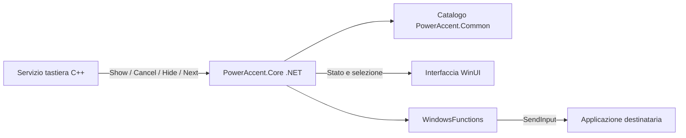

# Analisi di Quick Accent per la ricreazione di Accento

Analisi del 15 ottobre 2026 sulla versione installata **0.101.2362.0 x64**, con REA 6.5.0. La ricreazione può conservare il flusso lettera, selettore e sostituzione, separando in Rust le regole di input dalla finestra Glass. Il rischio principale è la sostituzione nel destinatario, soprattutto quando il contesto cambia o l'invio riesce solo in parte.

Il [piano di ricreazione](piano-ricreazione-rust.md) traduce questi risultati in consegne verificabili. Le decisioni di prodotto già acquisite rimangono quelle di [prodotto.md](prodotto.md).

## Identità e perimetro delle evidenze

Quick Accent è installato in `%LOCALAPPDATA%/PowerToys/WinUI3Apps`; il relativo processo era presente durante l'inventario. Questa presenza non costituisce una prova dei gesti o del rendering.

| File installato | Dimensione | Risultato |
| --- | ---: | --- |
| PowerAccent.Core.dll | 117.600 byte | CIL .NET 10, x64; regole, coordinamento e inserimento |
| PowerAccent.Common.dll | 54.624 byte | CIL .NET 10, x64; catalogo caratteri |
| PowerToys.PowerAccent.dll | 330.592 byte | CIL .NET 10, x64; interfaccia WinUI |
| PowerToys.PowerAccentKeyboardService.dll | 686.944 byte | Identità del file inventariata; implementazione nativa non decompilata |
| PowerToys.PowerAccent.exe | 408.928 byte | Launcher inventariato, non decompilato |

Hash SHA-256, dimensioni, percorsi, versione dei file e fonti sono nel [manifest](evidenze/quick-accent/manifest.json). Le evidenze REA complete sono nel [bundle](evidenze/quick-accent/rea-bundle.json). I token dei metodi citati valgono soltanto per SHA-256 e MVID registrati.

Il tag pubblico `v0.101.2362.0` risolve al commit [`389b1a3827b2cf577723288df15437490ef0663a`](https://github.com/microsoft/PowerToys/commit/389b1a3827b2cf577723288df15437490ef0663a). È il riferimento sorgente della stessa versione; non è stata dimostrata la riproducibilità della build né l'equivalenza completa fra sorgente e binari.

REA ha esaminato metadati, istruzioni CIL, chiamate e dichiarazioni native senza caricare o eseguire le assembly. La decompilazione nativa non era disponibile: Ghidra non configurato, Hopper non supportato su Windows, IDA non configurato. Il percorso C++ è quindi descritto come **lettura del sorgente fissato**, non come osservazione del codice macchina installato. Non sono state eseguite prove di digitazione o misure di prestazioni.

## Struttura ricostruita

Il binario Core registra i callback `SetShowToolbarEvent`, `SetCancelToolbarEvent`, `SetHideToolbarEvent`, `SetNextCharEvent` e `SetIsLanguageLetterDelegate`. Espone a sua volta `OnChangeDisplay` e `OnSelectCharacter` alla UI. Le dichiarazioni e chiamate sono osservate nelle evidenze E2 ed E3.

Il confine è utile per Accento, ma non richiede una DLL C++, un runtime .NET o le integrazioni della suite: le stesse responsabilità possono vivere in due crate Rust, come proposto nel piano.

## Attivazione e gestione della sessione

Nel [servizio tastiera del commit fissato](https://github.com/microsoft/PowerToys/blob/389b1a3827b2cf577723288df15437490ef0663a/src/modules/poweraccent/PowerAccentKeyboardService/KeyboardListener.cpp), `InitHook` installa `WH_KEYBOARD_LL`. Il servizio conserva la lettera proprietaria del gesto e distingue le modalità Spazio, frecce, entrambe e pressione prolungata. Il rilascio della proprietaria termina il gesto; un altro rilascio non deve confermarlo. Le false partenze nei modi con tasto aggiuntivo possono restituire Spazio o una freccia al destinatario. Le esclusioni e la modalità gioco condizionano l'attivazione. Questi sono risultati della lettura C++, non di una prova runtime.

Il percorso temporale richiede attenzione: il servizio usa il proprio cronometro per la soglia al rilascio, mentre `ShowToolbar` avvia un'apertura ritardata nella UI. Il motore Core prepara i candidati prima della visualizzazione. Non si può interpretare il nome interno `IsVisible` come prova che un frame sia già apparso sullo schermo.

Nella configurazione locale letta: attivazione `Both` (valore 2 nell'enum sorgente), ritardo 300 ms, posizione superiore centrale, set `IT,CUR`, descrizione e ordinamento per frequenza disattivati. Sono preferenze di questa installazione, non i valori definitivi di Accento.

## Selezione e apertura ritardata

Nel Core installato REA osserva `ShowToolbar`, `CancelToolbar`, `ProcessNextChar` e `SendInputAndHideToolbar`, insieme al campo `_selectedIndex`. `DelayedDisplayState` usa una generazione per invalidare un'apertura precedente dopo annullamento o nuova sessione: E2 ed E3.

La lettura di [PowerAccent.cs](https://github.com/microsoft/PowerToys/blob/389b1a3827b2cf577723288df15437490ef0663a/src/modules/poweraccent/PowerAccent.Core/PowerAccent.cs) precisa la navigazione: Spazio avanza, Shift può invertirne il verso, le frecce ciclano. La prima freccia può partire dalla zona centrale, salvo l'opzione di partenza da sinistra. Nei modi con tasto aggiuntivo l'evento che attiva può già alimentare la selezione prima dell'effettiva apparizione. Maiuscole e conversioni speciali sono gestite nel Core; il sorgente usa Caps Lock oppure Shift per la conversione iniziale.

Accento propone invece un'apertura senza candidato selezionato, navigazione successiva esplicita e famiglia maiuscola fissata all'avvio. È una differenza intenzionale da provare, non una parità già ottenuta.

## Sostituzione e invio Unicode

REA collega `SendInputAndHideToolbar` (`0x06000264`) a `WindowsFunctions.Insert` (`0x06000280`). Nel corpo CIL di `Insert` compaiono due chiamate a `SendInput` e una a `Thread.Sleep`; le dichiarazioni P/Invoke sono confermate separatamente in E4.

Il [sorgente WindowsFunctions.cs](https://github.com/microsoft/PowerToys/blob/389b1a3827b2cf577723288df15437490ef0663a/src/modules/poweraccent/PowerAccent.Core/Tools/WindowsFunctions.cs) spiega la sequenza: Backspace down/up, attesa di 1 ms, coppie Unicode down/up per ogni unità UTF-16. Gli eventi usano `dwExtraInfo = 0x110`, un marcatore della suite. I conteggi restituiti sono controllati e gli invii incompleti vengono registrati; l'errore del primo invio non rende atomico il secondo. Il commento motiva l'attesa con la compatibilità dei terminali.

Per Accento occorrono un marcatore proprio, esiti distinti per cancellazione e inserimento, nessun reinvio automatico dopo errore parziale e prove con invio unico e separato. Il valore di 1 ms non diventa un requisito per Rust.

La documentazione [SendInput](https://learn.microsoft.com/en-us/windows/win32/api/winuser/nf-winuser-sendinput) conferma che il risultato conta eventi inseriti nel flusso: non certifica il testo finale. UIPI limita i destinatari raggiungibili e non offre un errore che identifichi sempre quel blocco. La verifica del focus riduce il rischio di invio al destinatario sbagliato, senza rendere transazionale la modifica di un documento esterno.

## Catalogo e ordinamento

REA conferma l'assembly Common e il collegamento dal Core al catalogo. Nella selezione di `CharacterMappings`, le righe dei membri hanno copertura completa, mentre la lettura delle stringhe è **parziale**: 59 segnalazioni sul flag terminale dello stream `#US`. Le stringhe UTF-16 leggibili sono conservate, ma questo risultato non certifica tutte le mappature né un difetto runtime dell'app: E7 ed E8.

Il [catalogo sorgente fissato](https://github.com/microsoft/PowerToys/blob/389b1a3827b2cf577723288df15437490ef0663a/src/modules/poweraccent/PowerAccent.Common/CharacterMappings.cs) ordina gruppi e lingue esplicitamente, concatena i candidati e deduplica. Per l'italiano associa a `e` anche schwa ed euro, oltre a `è` ed `é`. Il set di Accento va quindi definito come scelta di prodotto: la lista illustrativa `è é ê ë` dei documenti non è il set italiano Quick Accent.

## Finestra e implicazioni per il Glass

Il binario UI presenta `MainWindow`, `SelectorControl`, `SelectorViewModel`, chiamate a `TransparentWindow`, dispatcher, scorrimento della selezione e controllo always-on-top: E5 ed E6.

Il [sorgente della finestra](https://github.com/microsoft/PowerToys/blob/389b1a3827b2cf577723288df15437490ef0663a/src/modules/poweraccent/PowerAccent.UI/PowerAccentXAML/MainWindow.xaml.cs) prepara il layout mentre la finestra è nascosta mediante cloaking e attende il commit della composizione prima di rivelarla. Invalida le operazioni ritardate e rimuove always-on-top alla chiusura. Il [controllo XAML](https://github.com/microsoft/PowerToys/blob/389b1a3827b2cf577723288df15437490ef0663a/src/modules/poweraccent/PowerAccent.UI/PowerAccentXAML/SelectorControl.xaml) usa una superficie unica, una riga scorrevole, celle di larghezza minima e una descrizione facoltativa.

Sono indicazioni per verificare primo frame, testi larghi, DPI e costo della finestra inattiva. Non dimostrano l'aspetto della copia in esecuzione né impongono WinUI ad Accento. Il Glass di Accento conserva la propria direzione descritta in [design.md](design.md), con caratteri dominanti e fallback opaco.

## Registro delle evidenze REA

Gli identificativi seguenti sono ricercabili nel bundle esportato. Le pagine consultate derivano dai rispettivi record e non rieseguono l'analisi.

| Riferimento | Evidence ID del record originale | Perimetro e forza della conclusione |
| --- | --- | --- |
| E1 | `ev_f8c10e29d1d10f51a3892c0cedc0d992e33b08accaefa6e6aa21bcf1f9a4ac8f` | Identità Core, MVID, .NET 10 e classificazione CIL; metadati completi |
| E2 | `ev_cdc56c750a87c4cede70744225f8e2ebf10685364a474e6cd0313ac4176350e0` | Inventario Core: 106 tipi e 870 metodi; non equivale a revisione semantica di tutti i metodi |
| E3 | `ev_f4eb03a282f01c2acc4c38783c0564defe663077fb2acb2453eaba3bfa1803e2` | Cinque tipi selezionati: PowerAccent, DelayedDisplayState, CharacterMappings, WindowsFunctions, SettingsService; chiamate e ancoraggi CIL |
| E4 | `ev_34967fa87fa9b72eb420aae4fe5a0094ea1f13c26927ea9158fc40ee51142d8c` | Otto dichiarazioni P/Invoke Core, fra cui SendInput; dichiarazioni, non risoluzione o chiamate osservate a runtime |
| E5 | `ev_4902e96c3abb8648e2e605e63a019dfa09c53c1b4d85dc8b676866eac4a90dd3` | Identità e framework dell'assembly UI |
| E6 | `ev_72d4989a2a311263568503d8ba81fe28f3f6cad1918c192ebaf18f64da330c08` | Tre tipi UI selezionati; 29 metodi, 151 relazioni di chiamata |
| E7 | `ev_1c55e6333b98aa0fb3a44bf5499cc91759d92fd7d0acfd16888517c248c236ef` | Identità e classificazione Common |
| E8 | `ev_a6cd54157c5755dd8b31300bd6c3eae1bb90413eba03c2cb4baf486d618ed9a0` | CharacterMappings Common; membri completi nel perimetro, stringhe parziali |

## Domande risolte e verifiche ancora necessarie

| Domanda iniziale | Stato | Conseguenza |
| --- | --- | --- |
| Quale versione stiamo ricreando? | Risolta | Identità locale e commit pubblico fissati |
| Come sono divisi tastiera, catalogo e UI? | Risolta per metadati e sorgente | Responsabilità traducibili in Rust |
| Come funziona la sostituzione? | Risolta staticamente nel Core | Prototipo Backspace e Unicode con controllo degli esiti |
| Quali sono esattamente tutti i rami del servizio nativo installato? | Parziale | Disponibile il sorgente della versione; manca la verifica del codice macchina |
| L'input funziona nei programmi della matrice? | Da verificare a runtime | Nessuna dichiarazione di compatibilità prima delle prove |
| Quale materiale e framework soddisfano il Glass? | Scelta da provare | Esperimento nativo con focus, accessibilità e consumi |
| Rust migliora prestazioni e dimensione? | Da misurare | Confronto a parità di macchina e carico |

La sorgente Microsoft consultata riporta licenza MIT e il [LICENSE del commit](https://github.com/microsoft/PowerToys/blob/389b1a3827b2cf577723288df15437490ef0663a/LICENSE) è incluso nel manifest delle fonti. Questa analisi non incorpora sorgenti, font o asset nel prodotto. Qualsiasi futuro riuso va tracciato con gli avvisi richiesti e con la provenienza della risorsa specifica.
