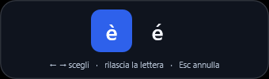

# Verifiche di Accento 0.1.0

Il 15 ottobre 2026 è stata compilata la prima applicazione Windows di Accento. Il prototipo realizza il flusso lettera, selettore e inserimento con focus conservato nei campi Edit di collaudo. I risultati seguenti riguardano questo ambiente e questi scenari.

## Implementazione presente

Due crate Rust separano macchina a stati e integrazione Windows. Il selettore non attivante usa Direct2D e DirectWrite, backdrop DWM transitorio quando disponibile e alternativa opaca. È mostrato solo durante il gesto; timer e lavoro grafico non rimangono continuamente attivi a riposo.

Sono presenti tray con pausa, ripresa, impostazioni e uscita; istanza unica; preferenze JSON con schema e sostituzione atomica del file; set comuni italiano, francese, spagnolo e tedesco; esclusioni esatte per nome dell'eseguibile. Il nome accessibile del selettore contiene candidati e scelta; le notifiche UI Automation sono inviate se un client ascolta.

L'inserimento usa un batch SendInput comprendente Backspace e Unicode, marcato per evitare ricorsioni. Prima dell'invio ricontrolla finestra, controllo focalizzato e thread. Nuovi down, click, rotellina e cambi di contesto invalidano gli effetti pendenti. Un invio incompleto non viene ripetuto automaticamente.

## Ambiente

| Voce | Valore |
| --- | --- |
| Sistema | Windows x64, build 26300, DisplayVersion 26H2 |
| Rust | rustc 1.98.0, cargo 1.98.0 |
| Profilo eseguibile | Release ottimizzato, target x86_64-pc-windows-msvc |
| Runtime C | Collegamento statico; tabella import dell'eseguibile priva di VCRUNTIME140.dll |
| Integrazione API | windows 0.62.2; tutte le dipendenze in Cargo.lock |
| Destinatario di collaudo | Finestra e due controlli Edit Windows creati dal programma |
| Input di prova | Sequenze sintetiche marcate per il collaudo, elaborate dal listener reale |

Il collaudo apre una finestra propria e termina il processo al termine. Non modifica preferenze reali: le variazioni di tema ed esclusioni sono in memoria. Il test del salvataggio usa una cartella temporanea propria.

Hash dell'eseguibile, archivio e Cargo.lock sono nel [manifest della build](evidenze/0.1.0/build.json); gli esiti Windows sono nel [rapporto originale](evidenze/0.1.0/windows-self-test.txt).

## Risultati automatici

| Verifica | Esito |
| --- | --- |
| cargo test --workspace --locked | 14 test del motore e 2 delle preferenze superati |
| cargo clippy --workspace --all-targets --locked -- -D warnings | Superato |
| cargo fmt --all -- --check | Superato |
| Compilazione release | Superata |
| Accento.exe --self-test | 18 controlli superati nell'ambiente sopra |

I test del motore coprono soglia del timer, conferma, false partenze, annullamento, coppie down/up, ripetizioni prima e dopo l'attivazione, timer scaduti, cambio destinatario, maiuscole, direzione, ritorno all'altro estremo e deduplicazione. Le preferenze verificano validazione e sostituzione del file soltanto con valori validi.

Il collaudo Windows verifica `è`, `È`, focus conservato, Esc, falso avvio con restituzione di Spazio, rilascio senza scelta, seconda pressione di Spazio, Sinistra verso l'ultimo candidato, cambio campo senza invio, pausa ed esclusione esatta. Per ciascun aspetto verifica anche visibilità della barra e inserimento dopo il cambio. L'ultimo controllo verifica la disponibilità del destinatario di collaudo.

Durante l'estensione delle prove è emerso un aggiornamento mancato del contesto in alcune transizioni di foreground. Il listener ora confronta anche il destinatario a ogni evento e pianifica l'aggiornamento del processo fuori dal callback. Quando sono configurate esclusioni e il contesto non è ancora risolto, evita l'attivazione.

## Controllo visivo

Le catture del selettore reale chiaro, scuro e opaco mostrano una singola superficie, selezione distinguibile e diacritici leggibili. Il controllo è circoscritto alla scala e alla macchina del collaudo; non dimostra trasparenza percepita su tutti gli sfondi né conformità all'accessibilità.

Sono disponibili anche la [variante opaca](evidenze/0.1.0/picker-2.png) e la [finestra impostazioni](evidenze/0.1.0/settings.png).

I file di collaudo vengono generati accanto all'eseguibile soltanto con `--self-test`. Il pacchetto normale non raccoglie schermate o testo digitato.

## Verifiche ancora aperte

Word, browser con input e contenteditable, VS Code, terminali, selezioni, autocorrezione e destinatari lenti richiedono prove separate. Non è stata dimostrata la compatibilità generale con contesti elevati, password web, IME, desktop remoto e tutti i layout internazionali.

Sono implementati adattamento DPI, scala del testo e risposta al contrasto elevato, ma la matrice a più monitor 100/150/200 per cento e Narrator non è stata completata. Il selettore non espone ancora una struttura UI Automation con un elemento distinto per ogni candidato. La qualità della finestra impostazioni resta quella dei controlli nativi, con tema del selettore configurabile.

CPU, memoria, latenza, dimensione confrontata con Quick Accent e consumi della GPU non sono stati oggetto di benchmark. Non si dichiarano vantaggi prestazionali comparativi. La build minima 22621, installazione, aggiornamento, firma e ARM64 rimangono attività successive.
